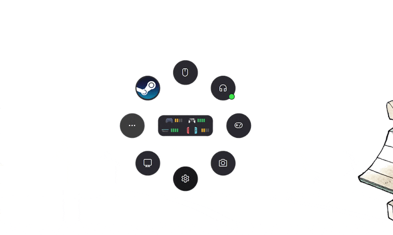
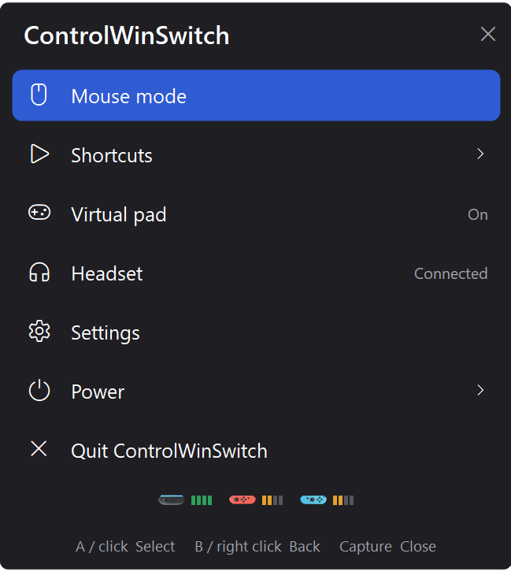
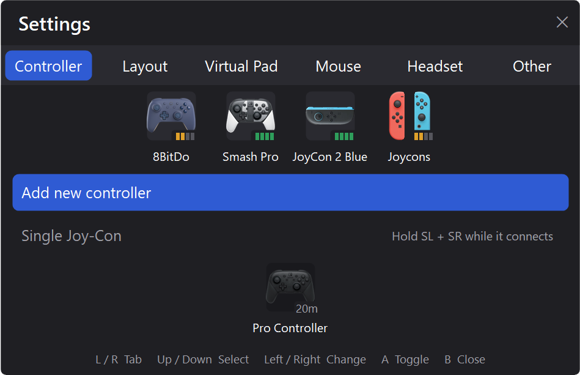
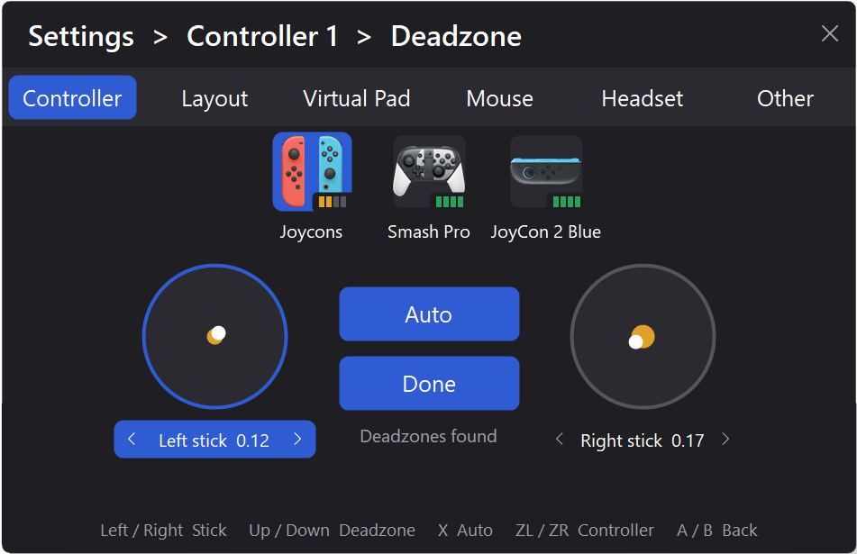

# ControlWinSwitch


A background app that turns Nintendo Switch controllers as an Xbox or PS4 controller.

Pressing the **Capture** button let you open a customizable menu allowing all kind of shortcuts!


## Features

- **Menu on Capture**: a list or radial menu overlay, **fully editable.**
- **Mouse mode**: sticks move the cursor and scroll, A / B click.
- **Virtual pad**: each controller drives its own virtual Xbox 360 or DualShock 4 pad through ViGEmBus, replacing alternatives like BetterJoy or DS4Windows.
- **HidHide integration**: the physical controller is hidden from games while its virtual pad is on.
- **Up to four controllers**, each with a name, picture, battery badge, player lights, stick calibration and deadzone.
- All kinds of **Windows actions**: launch apps and URLs, move display settings, change volume or brightness, take screenshots, connect a Bluetooth headset, trigger power actions.


## Screenshots







## Requirements
- Windows 10/11, x64
- [ViGEmBus](https://github.com/nefarius/ViGEmBus)
- [HidHide](https://github.com/nefarius/HidHide), so games see only the virtual pad

## Install

1. Download `ControlWinSwitch-<version>-win-x64.zip` from the [Releases](../../releases) page and unzip it to any folder.
2. Install [ViGEmBus](https://github.com/nefarius/ViGEmBus) and [HidHide](https://github.com/nefarius/HidHide).
3. Start `ControlWinSwitch.exe`. The app runs invisibly apart from its tray icon. Click on the tray icon, press **Capture** on your controller, or CTRL+ALT+M to open the menu.
4. To start it with Windows: Settings → **Other** → **Launch on startup**.

To uninstall: turn Launch on startup off, quit ControlWinSwitch and delete its folder. 
Settings are stored in `%APPDATA%\ControlWinSwitch\`.

## Build from source

Needs the .NET SDK 10 and the **C++ build tools** (NativeAOT links with the MSVC linker).

```bash
# vswhere must be on PATH, otherwise the NativeAOT link step fails
export PATH="$PATH:/c/Program Files (x86)/Microsoft Visual Studio/Installer"
dotnet publish src/ControlWinSwitch -c Release -o dist
```

The result is `dist\ControlWinSwitch.exe`.

## FAQ

### Windows says the app is unsafe / Defender blocks it

ControlWinSwitch is not code-signed (a signing certificate costs money every year), so Windows doesn't know it yet:

- **"Windows protected your PC"** (SmartScreen): click **More info → Run anyway**.
- **Defender removes the file** ("Trojan:Win32/..."): this is a false positive. Defender is suspicious of new unsigned apps that, like this one, run as administrator, simulate the mouse and hide devices from other apps. Restore it from **Windows Security → Virus & threat protection → Protection history → Allow on device**, or add the app's folder to the exclusions.

The app is open source: you can read the code and [build it yourself](#build-from-source). Each release lists the SHA-256 of the zip, so you can check you got the official file: `Get-FileHash ControlWinSwitch-<version>-win-x64.zip`.

### Which controller are supported?

As of today, only Nintendo Switch Pro Controller (or equivalent third-party controllers that act as a Pro Controller),
Switch 1 Joy-Cons and Switch 2 Joy-Cons are supported.

I would love to add more, but I don't have other controller on me!

### Why can't I see my node picture?

If your image is a .ico or .png files but is not showing, it could be because your image is actually a .webp file.

Please convert it to a real .png.   


## Credits

- [BetterJoy](https://github.com/Davidobot/BetterJoy), the reference for what this app replaces.
- [dekuNukem's Nintendo Switch reverse engineering notes](https://github.com/dekuNukem/Nintendo_Switch_Reverse_Engineering) for the HID report formats.
- [switch2-controllers](https://github.com/Nadeflore/switch2-controllers) by Nadeflore for the Joy-Con 2 Bluetooth LE protocol.
- [HidHide](https://github.com/nefarius/HidHide) and [ViGEmBus](https://github.com/nefarius/ViGEmBus) by Nefarius.

This app was co-developed using Claude.

## License

MIT, see [LICENSE](LICENSE).
